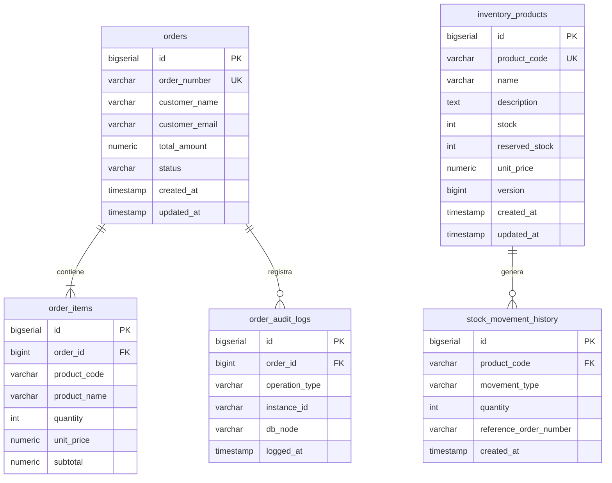

# Database Architecture & Persistence Schema
## Replicación PostgreSQL Streaming WAL, Topología y Modelo Entidad-Relación

Este documento detalla la arquitectura de persistencia para `order-service` (base de datos relacional replicada física mediante streaming WAL) e `inventory-service`, respetando el aislamiento de bases de datos por microservicio (Database-per-Service).

---

## 1. Regla de Aislamiento: Database-per-Service
Para cumplir con los principios de microservicios y las restricciones del proyecto:
1. `order-service` gestiona sus propias tablas en la base de datos `orders_db` (alojada en el cluster PostgreSQL Primary + 2 Réplicas WAL).
2. `inventory-service` gestiona su propia persistencia en `inventory_db` (o esquema privado aislado).
3. **Ningún servicio accede directamente a las tablas del otro:** Toda consulta o reserva de stock se realiza estrictamente vía API REST utilizando nombres lógicos descubiertos en Eureka (`lb://inventory-service`).

---

## 2. Esquema Relacional de `order-service` (`orders_db`)

El microservicio de pedidos utiliza un modelo de orden con detalle de ítems e historial de eventos para auditoría de lecturas y transacciones:

```sql
-- 1. Tabla principal de Pedidos
CREATE TABLE orders (
    id BIGSERIAL PRIMARY KEY,
    order_number VARCHAR(64) UNIQUE NOT NULL,
    customer_name VARCHAR(150) NOT NULL,
    customer_email VARCHAR(150) NOT NULL,
    total_amount NUMERIC(12, 2) NOT NULL DEFAULT 0.00,
    status VARCHAR(30) NOT NULL DEFAULT 'PENDING', 
    -- Estados: PENDING, CONFIRMED, REJECTED, CANCELLED
    created_at TIMESTAMP WITH TIME ZONE DEFAULT CURRENT_TIMESTAMP,
    updated_at TIMESTAMP WITH TIME ZONE DEFAULT CURRENT_TIMESTAMP
);

-- 2. Tabla de Detalles del Pedido (Líneas de Compra)
CREATE TABLE order_items (
    id BIGSERIAL PRIMARY KEY,
    order_id BIGINT NOT NULL REFERENCES orders(id) ON DELETE CASCADE,
    product_code VARCHAR(50) NOT NULL,
    product_name VARCHAR(150) NOT NULL,
    quantity INT NOT NULL CHECK (quantity > 0),
    unit_price NUMERIC(10, 2) NOT NULL CHECK (unit_price >= 0),
    subtotal NUMERIC(12, 2) NOT NULL
);

-- 3. Tabla de Auditoría de Enrutamiento y Réplicas (Para verificar P05 y P07)
CREATE TABLE order_audit_logs (
    id BIGSERIAL PRIMARY KEY,
    order_id BIGINT REFERENCES orders(id) ON DELETE SET NULL,
    operation_type VARCHAR(30) NOT NULL, -- INSERT, SELECT_CRITICAL, SELECT_ORDINARY
    instance_id VARCHAR(100) NOT NULL,  -- Instancia de order-service que procesó
    db_node VARCHAR(30) NOT NULL,       -- PRIMARY, REPLICA_1, REPLICA_2
    logged_at TIMESTAMP WITH TIME ZONE DEFAULT CURRENT_TIMESTAMP
);

-- Índices estratégicos para lecturas rápidas en réplicas
CREATE INDEX idx_orders_status ON orders(status);
CREATE INDEX idx_orders_customer_email ON orders(customer_email);
CREATE INDEX idx_order_items_order_id ON order_items(order_id);
CREATE INDEX idx_order_items_product_code ON order_items(product_code);
```

---

## 3. Esquema Relacional de `inventory-service` (`inventory_db`)

El microservicio de inventario mantiene el catálogo y controla el stock con bloqueo optimista/pesimista para garantizar consistencia transaccional en reservas concurrentes:

```sql
-- 1. Tabla de Catálogo y Stock de Productos
CREATE TABLE inventory_products (
    id BIGSERIAL PRIMARY KEY,
    product_code VARCHAR(50) UNIQUE NOT NULL,
    name VARCHAR(150) NOT NULL,
    description TEXT,
    stock INT NOT NULL DEFAULT 0 CHECK (stock >= 0),
    reserved_stock INT NOT NULL DEFAULT 0 CHECK (reserved_stock >= 0),
    unit_price NUMERIC(10, 2) NOT NULL CHECK (unit_price > 0),
    version BIGINT NOT NULL DEFAULT 0, -- Bloqueo optimista JPA (@Version)
    created_at TIMESTAMP WITH TIME ZONE DEFAULT CURRENT_TIMESTAMP,
    updated_at TIMESTAMP WITH TIME ZONE DEFAULT CURRENT_TIMESTAMP
);

-- 2. Historial de Movimientos de Stock (Auditoría de Reservas)
CREATE TABLE stock_movement_history (
    id BIGSERIAL PRIMARY KEY,
    product_code VARCHAR(50) NOT NULL,
    movement_type VARCHAR(30) NOT NULL, -- RESERVATION, RELEASE, RESTOCK
    quantity INT NOT NULL,
    reference_order_number VARCHAR(64),
    created_at TIMESTAMP WITH TIME ZONE DEFAULT CURRENT_TIMESTAMP
);

CREATE INDEX idx_inventory_product_code ON inventory_products(product_code);
CREATE INDEX idx_stock_movement_product_code ON stock_movement_history(product_code);
```

---

## 4. Datos Iniciales de Prueba (Seed Data)

```sql
-- Inserción inicial en inventory-service
INSERT INTO inventory_products (product_code, name, description, stock, reserved_stock, unit_price, version)
VALUES 
('PROD-001', 'Laptop Dell XPS 15', 'Intel Core i9, 32GB RAM, 1TB SSD', 50, 0, 1899.99, 0),
('PROD-002', 'Monitor UltraWide 34"', 'LG Curved IPS 144Hz 1ms', 30, 0, 499.50, 0),
('PROD-003', 'Teclado Mecánico RGB', 'Switches Cherry MX Blue, Wireless', 100, 0, 89.90, 0),
('PROD-004', 'Mouse Ergonómico Inalámbrico', 'Sensor óptico 16000 DPI', 75, 0, 59.99, 0),
('PROD-005', 'Auriculares Noise Cancelling', 'Cancelación activa de ruido Bluetooth', 40, 0, 199.00, 0);
```

---

## 5. Diagrama Entidad-Relación (ERD)



---

## 6. Topología de Replicación Física WAL y Balanceo de Réplicas

```text
                                   [ order-service ]
                                           │
                           ┌───────────────┴───────────────┐
                   (Escritura / Crítica)             (Lectura Ordinaria)
                           │                               │
                           ▼                               ▼
                 ┌──────────────────┐            ┌───────────────────┐
                 │  Primary Router  │            │ Replica LB (R-R)  │
                 └─────────┬────────┘            └─────────┬─────────┘
                           │                               │
                           ▼                               ▼
                   ┌──────────────┐             ┌─────────────────────┐
                   │  pg-primary  │             │   Replica Health    │
                   │  Port :5432  │             │      Registry       │
                   └───────┬──────┘             └──────────┬──────────┘
                           │                               │
             Streaming WAL │                     ┌─────────┴─────────┐
             (hot_standby) │                     ▼                   ▼
                           ├─────────────> ┌───────────┐       ┌───────────┐
                           │               │ pg-rep-1  │       │ pg-rep-2  │
                           └─────────────> │ Port:5433 │       │ Port:5434 │
                                           └───────────┘       └───────────┘
```

### Comportamiento del Enrutador ante Fallos (P06 / P08):
1. **Detección de fallo:** Si `pg-rep-1` se detiene, el pool de conexiones de HikariCP detecta la falla o el healthcheck activo marca `pg-rep-1` en estado `UNHEALTHY`.
2. **Desvío transparente:** Las lecturas son enviadas al 100% hacia `pg-rep-2`.
3. **Reincorporación automática:** Al levantarse `pg-rep-1`, un hilo programado (`@Scheduled`) ejecuta `SELECT 1` periódicamente; al recibir respuesta exitosa, lo vuelve a admitir en la rotación Round-Robin.
