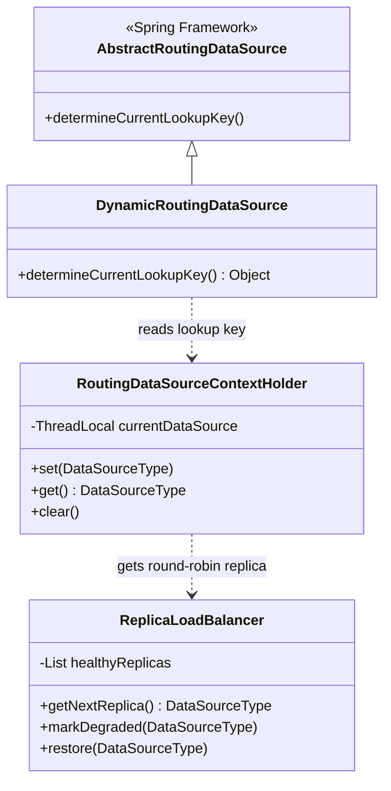

# Database Architecture & Persistence
## Replicación PostgreSQL Streaming WAL & Enrutamiento de Consultas

### 1. Modelo Entidad-Relación

#### Servicio de Pedidos (`order-service`)
```sql
CREATE TABLE orders (
    id BIGSERIAL PRIMARY KEY,
    customer_name VARCHAR(150) NOT NULL,
    product_code VARCHAR(50) NOT NULL,
    quantity INT NOT NULL,
    unit_price NUMERIC(10, 2) NOT NULL,
    total_price NUMERIC(10, 2) NOT NULL,
    status VARCHAR(30) NOT NULL DEFAULT 'CONFIRMED',
    created_at TIMESTAMP WITH TIME ZONE DEFAULT CURRENT_TIMESTAMP
);
```

#### Servicio de Inventario (`inventory-service`)
```sql
CREATE TABLE inventory_items (
    id BIGSERIAL PRIMARY KEY,
    product_code VARCHAR(50) UNIQUE NOT NULL,
    product_name VARCHAR(150) NOT NULL,
    stock INT NOT NULL DEFAULT 0,
    unit_price NUMERIC(10, 2) NOT NULL
);
```

---

### 2. Topología de Replicación Física Streaming WAL

```text
                        ┌───────────────────────────────┐
                        │      PostgreSQL Primary       │
                        │       (Escrituras / WAL)      │
                        │          Port: 5432           │
                        └───────────────┬───────────────┘
                                        │
                         Streaming WAL  │  (TCP / Port 5432)
                                        │
                     ┌──────────────────┴──────────────────┐
                     ▼                                     ▼
        ┌─────────────────────────┐           ┌─────────────────────────┐
        │  PostgreSQL Replica 1   │           │  PostgreSQL Replica 2   │
        │     (Lecturas WAL)      │           │     (Lecturas WAL)      │
        │       Port: 5433        │           │       Port: 5434        │
        └─────────────────────────┘           └─────────────────────────┘
```

#### Parámetros Críticos en `postgresql.conf` del Primary:
- `wal_level = replica`: Genera registros de transacciones suficientes para soportar réplicas físicas.
- `max_wal_senders = 10`: Permite conexiones concurrentes de streaming WAL.
- `wal_keep_size = 256MB`: Evita que el nodo primario purgue segmentos WAL antes de que las réplicas los consuman.
- `hot_standby = on`: Habilita lecturas concurrentes en los nodos réplica.

---

### 3. Implementación de `AbstractRoutingDataSource`



1. **Escrituras:** Siempre dirigidas a `DataSourceType.PRIMARY`.
2. **Lecturas Ordinarias (`@Transactional(readOnly = true)`):** Dirigidas de forma alternada a `DataSourceType.REPLICA_1` y `DataSourceType.REPLICA_2`.
3. **Lecturas Críticas (`@ReadFromPrimary` o cabecera `X-Consistency: critical`):** Dirigidas al `DataSourceType.PRIMARY` para prevenir inconsistencias de replicación eventual.
