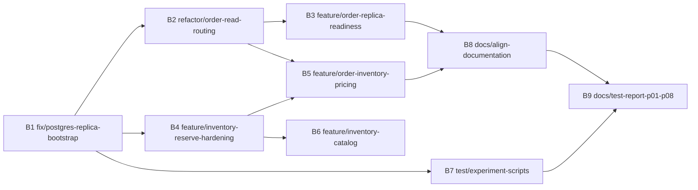

# Plan de implementación

Plan para resolver las tareas de [TAREAS_PENDIENTES.md](TAREAS_PENDIENTES.md). Cada rama agrupa tareas relacionadas, indica de qué rama depende e incluye un checklist para marcar el avance.

---

## 0. Principios y reglas del plan

### 0.1 Invariantes del proyecto (AGENTS.md) — no se cambian

| Invariante | Consecuencia en este plan |
|---|---|
| Backend API / microservicios | Sin frontend. Toda mejora se expone como API REST |
| Greenfield, release funcional | Se corrige y endurece lo que existe; no se agregan dominios nuevos |
| Concurrencia moderada (< 1.000 req/min) | Sin caché distribuida ni colas. La concurrencia de stock se resuelve en SQL |
| PostgreSQL relacional | Sin NoSQL. Replicación física WAL, 1 primario + 2 réplicas |
| Sin autenticación | No se agrega Spring Security. Los endpoints administrativos quedan como limitación documentada |
| Tests unitarios + integración con CI | Cada rama trae sus tests. Se agregan tests de integración con Testcontainers |
| Docker Compose | Compose es el despliegue de referencia. Swarm se mantiene alineado, pero no es prioridad |
| Logging estructurado básico | Logs `clave=valor` con MDC (`correlationId`, `instanceId`, `dbNode`). Sin Prometheus ni Grafana |

### 0.2 Principios de diseño

- **Controladores delgados:** el controlador solo traduce HTTP ↔ DTO. La lógica de negocio va en `service/` y la de enrutamiento de BD en `datasource/`.
- **Dependencias hacia abstracciones:** el controlador depende de `OrderQueryService` / `OrderCommandService`; el servicio, de `ReplicaSelector` e `InventoryStockClient`. Las implementaciones se pueden sustituir en tests.
- **Transacciones cortas y explícitas:** nunca se mantiene una transacción abierta durante una llamada HTTP a otro servicio. Cada intento de lectura abre su propia transacción.
- **Configuración externa:** umbrales, intervalos y timeouts van en `@ConfigurationProperties` con valores por defecto. No hay constantes mágicas.
- **Escalable a N réplicas:** la lista de réplicas viene de configuración, no de un `if r1 / else r2`.
- **Sin librería compartida entre servicios:** pequeñas piezas transversales, como el filtro de `correlationId`, se duplican en cada servicio. Una librería común acoplaría los ciclos de despliegue, y con dos servicios no compensa.
- **Contratos compatibles hacia atrás:** los cambios de contrato entre servicios agregan campos y no eliminan los existentes en la misma rama.
- **Fallar rápido y con el código HTTP correcto:** 400 para entrada inválida, 404 si no existe, 503 si una dependencia no está disponible. Los errores técnicos usan `ProblemDetail` (RFC 7807, nativo de Spring 6).

### 0.3 Convenciones de trabajo

- **Ramas:** siempre desde `develop` actualizado. El prefijo indica el tipo: `fix/`, `feature/`, `refactor/`, `test/`, `docs/`.
  ```bash
  git switch develop && git pull
  git switch -c <rama>
  ```
- **Commits:** Conventional Commits (`fix(order): ...`, `feat(inventory): ...`), igual que el historial actual.
- **Antes de cada push:**
  ```bash
  mvn -f src/pom.xml spotless:apply
  mvn -f src/pom.xml verify -pl <servicio>
  ```
- **Integración:** Pull Request hacia `develop`, con revisión de al menos un integrante y el CI en verde.
- **Definition of Done (aplica a todas las ramas):**
  - [ ] Los tests nuevos y los existentes pasan en local y en CI.
  - [ ] Spotless y Checkstyle sin errores.
  - [ ] La prueba P0x afectada se verificó manualmente con `docker compose up`.
  - [ ] La documentación afectada se actualizó en la misma rama.
  - [ ] No hay secretos ni contraseñas reales en el diff.

---

## 1. Mapa de ramas

| # | Rama | Servicio | Tareas | Depende de | Prioridad |
|---|---|---|---|---|---|
| B1 | `fix/postgres-replica-bootstrap` | Infraestructura + Gateway | INF-01, INF-02, INF-03, GW-01 | — | 🔴 Primera |
| B2 | `refactor/order-read-routing` | order-service | ORD-01, ORD-03, ORD-04, ORD-08 | B1 | 🔴 |
| B3 | `feature/order-replica-readiness` | order-service | ORD-02, ORD-05, cabecera `X-Replication-Lag-Ms` | B2 | 🔴 |
| B4 | `feature/inventory-reserve-hardening` | inventory-service | INV-01 a INV-06 | B1 | 🟠 |
| B5 | `feature/order-inventory-pricing` | order-service | ORD-06, ORD-07 | B2, B4 | 🟡 |
| B6 | `feature/inventory-catalog` *(opcional)* | inventory-service | INV-07 | B4 | 🟡 |
| B7 | `test/experiment-scripts` | Scripts / colecciones | DOC-08, DOC-09 | B1 | 🟠 |
| B8 | `docs/align-documentation` | Documentación | DOC-04, DOC-05, DOC-06, DOC-07, DOC-10, DOC-11 | B2–B5 | 🟠 |
| B9 | `docs/test-report-p01-p08` | Entregables | DOC-01, DOC-02, DOC-03 | Todas | 🔴 Última |
| B10 | `refactor/schema-migrations-flyway` *(opcional)* | Ambos servicios | Mejora de producción (sin ID) | B4, B5 | 🟡 |



**Trabajo en paralelo:** una vez fusionada B1, una persona puede avanzar la línea `order-service` (B2 → B3 → B5) mientras otra hace la de `inventory-service` (B4 → B6) y una tercera los scripts (B7). B5 conviene hacerla después de B2, porque ambas modifican `OrderController`.

---

## B1 · `fix/postgres-replica-bootstrap`

**Tareas:** INF-01, INF-02, INF-03, GW-01 · **Base:** `develop` · **Bloquea:** P05, P06, P08

> **Estado:** ✅ implementado y verificado (18 pasos de prueba manuales + smoke test) en los commits `9e315d8` (infra) y `ce16d7e` (gateway). Fusionada en `develop` (PR #6).

### Objetivo
Que las dos réplicas hagan `pg_basebackup` contra el primario, queden en `streaming` y que Compose arranque los servicios en el orden correcto.

### Diseño
- Parametrizar el host del primario en lugar de fijarlo en el script: `PRIMARY_HOST=${PRIMARY_HOST:-postgres-primary}`. El mismo script sirve para Compose y para Swarm.
- Agregar un `healthcheck` a las réplicas que exija que la instancia esté en recuperación (`pg_is_in_recovery()`). Así una réplica que acepta conexiones pero no replica no cuenta como sana.
- `order-service-*` debe depender de que las réplicas estén `healthy`. No es obligatorio, porque el balanceador tolera su ausencia, pero evita ruido en el arranque.

### Checklist
- [x] `docker/postgres/start-replica.sh`: usar `-h "${PRIMARY_HOST:-postgres-primary}"`.
- [x] `compose.yaml` y `deploy/docker-stack.yml`: definir `PRIMARY_HOST=postgres-primary` en ambas réplicas.
- [x] `healthcheck` en `postgres-replica1` y `postgres-replica2` con `SELECT pg_is_in_recovery()`. Se les pasa `POSTGRES_USER`, que es el superusuario heredado del primario.
- [x] `healthcheck` HTTP (`/actuator/health`) en `order-service-1`, `order-service-2`, `inventory-service` y `api-gateway` (INF-03).
- [x] `depends_on` de `api-gateway` → `order-service-*` e `inventory-service` en `condition: service_healthy`; `order-service-*` → réplicas `healthy`.
- [x] Crear `.env.example` en la raíz con valores ficticios (INF-02). `.gitignore` ya ignora `.env`.
- [x] TRD §4: corregir `pg_basebackup -h primary`.

**Añadido durante la implementación:**
- [x] Healthcheck del primario por TCP (`pg_isready -h 127.0.0.1`). Así no se marca sano mientras corre el servidor temporal de inicialización y desaparece el `Connection refused` inicial.
- [x] `start-replica.sh`: reintenta solo los errores transitorios y aborta con `exit 1` ante errores de configuración (credenciales, rol, `pg_hba.conf`).
- [x] Healthchecks con `start_period` + `retries: 3`: una caída se detecta en ~15 s en vez de 100–150 s.
- [x] Políticas de reinicio: `unless-stopped` en los servicios y `on-failure:5` en las réplicas.
- [x] Puertos del host configurables (`PG_PRIMARY_PORT`, etc.); el primario usa 5435 por defecto para no chocar con un PostgreSQL local.
- [x] Smoke test end-to-end: `scripts/ci/compose-smoke.sh` + `.github/workflows/ci-compose-smoke.yml`.
- [x] **GW-01:** cabeceras de trazabilidad del Gateway registradas con `beforeCommit`, con tests (detectado por el smoke test).

### Verificación
- [x] `docker compose down -v && docker compose up -d --build --wait`: todo levanta.
- [x] `docker compose ps`: los 8 contenedores en `healthy`.
- [x] `pg_stat_replication` devuelve 2 filas en `streaming`, y las réplicas devuelven `pg_is_in_recovery() = t`.
- [x] Los datos del primario aparecen en las dos réplicas, y una escritura en una réplica es rechazada.
- [x] Las lecturas por el Gateway llegan a `REPLICA_1` y `REPLICA_2`; `curl` termina con `rc=0` y con las cabeceras de trazabilidad.
- [x] Fallo rápido con contraseña incorrecta (`exit 1`) y reintento ante un primario no disponible.
- [x] Reinicio automático cuando el proceso cae; un `docker stop` manual se respeta.
- [x] Una réplica detenida y reiniciada vuelve a `healthy` y a `streaming` sin repetir la copia inicial.

---

## B2 · `refactor/order-read-routing`

**Tareas:** ORD-01, ORD-03, ORD-04, ORD-08 · **Base:** `develop` (con B1 fusionada) · **Afecta:** P05, P06, P07

> **Estado:** ✅ implementado y verificado en los commits `27e25fa` (apagado sin errores), `5973d03` (ORD-03), `b8a7f7b` (ORD-01, ORD-04), `d19a930` (ORD-09) y `9fa1bec` (ORD-08). `mvn verify`: 45 tests unitarios + 4 de integración con PostgreSQL real; Spotless y Checkstyle sin errores; smoke test en verde; P05, P06 (a través del Gateway), P07 y P08 comprobados en el clúster; 0 errores con tráfico continuo durante `docker stop` y `docker kill` de `order-service-1`. **Pendiente:** push, PR y merge en `develop`.

### Diagnóstico confirmado en el clúster (con `postgres-replica1` detenida)

| Tarea | Observado | Causa |
|---|---|---|
| **ORD-01** | `GET /api/orders` → la primera lectura devuelve **500** (`UnexpectedRollbackException: ... marked as rollback-only`) | Todos los intentos comparten una sola transacción. El fallo de la réplica la marca como rollback-only, y aunque el reintento lee bien, el commit final falla |
| **ORD-04** | `GET /api/orders/{id}` → **el 50% de las lecturas devuelve 500**, cada una tras unos 3 s | El endpoint no tiene failover y nunca marca la réplica como degradada, así que el Round-Robin la sigue eligiendo |
| **Presupuesto de tiempo** | Cada fallo tarda 3,0 s (el `connectionTimeout` de Hikari) | Es igual al `timelimiter` del Gateway (3 s). Un failover a través del Gateway superaría el límite y terminaría en 503, aunque se corrija ORD-01 |
| **ORD-03** | El nodo de BD solo aparece en la cabecera HTTP; el `X-Correlation-Id` no llega a los logs ni a `inventory-service` | No hay MDC ni propagación de la cabecera |
| **ORD-08** | El test de failover pasa con Mockito, pero en producción falla | No hay transacciones reales en los tests |

### Hallazgos durante la implementación (resueltos en B2)

| # | Problema | Causa | Solución |
|---|---|---|---|
| H1 | Con una réplica caída, **las dos** instancias de `order-service` pasaban a `DOWN` y el Gateway respondía 503 con el fallback del Circuit Breaker. Ya ocurría antes de B2; en Swarm habría causado reinicios en bucle | `/actuator/health` incluye el indicador `db` con **todos** los DataSource. El LoadBalancer del Gateway y Docker usaban ese endpoint | Probes de Spring Boot: el Gateway y Docker usan **`/actuator/health/readiness`**, que no depende de la BD compartida y así evita el fallo en cascada. `/actuator/health` sigue mostrando la BD para diagnóstico. Aplicado a `order-service` e `inventory-service` |
| H2 | 2 de 60 lecturas tardaban 3 s y el Gateway las cortaba | Con `docker stop`, la IP de la réplica desaparece y los paquetes se pierden sin respuesta. Una conexión usada hace menos de 500 ms no se revalida y la consulta esperaba el `socketTimeout` (5 s) | `replica-socket-timeout: 2s`. Peor caso = max(2 s, 0,75 s + 1 s) + lectura < 3 s. El test de integración no lo reproducía porque ahí el puerto rechaza la conexión al instante |

### Resultados medidos en el clúster (a través del Gateway)

| Prueba | Antes de B2 | Después de B2 |
|---|---|---|
| `GET /api/orders` con `postgres-replica1` detenida | 1.ª petición → **500** (`UnexpectedRollbackException`) | **60/60 → 200** (2 rondas), latencia máx. 1,0–1,2 s |
| `GET /api/orders/{id}` con `postgres-replica1` detenida | **50 % → 500**, 3 s cada una | Incluido en las 60/60 → 200 |
| Health con réplica caída | Ambas instancias `DOWN` → 503 del Gateway | readiness `UP`; health completo muestra `replica1DataSource: DOWN` |
| P08: reiniciar la réplica | — | Vuelve al reparto en ≤ 5 s (`replica.state ... to=UP`) |
| P05 en logs | Solo cabecera HTTP | `db.route op=WRITE node=PRIMARY` / `op=READ node=REPLICA_n` con `cid` e instancia |

### Objetivo
Sacar el enrutamiento y el failover del controlador hacia una capa dedicada y reutilizable. Cada intento de lectura usa su propia transacción. Los tiempos de espera quedan dentro del presupuesto del Gateway, y cada decisión de enrutamiento queda trazada en el log.

### Diseño

Se mantienen los paquetes actuales (`controller`, `datasource`, `dto`, `model`, `repository`, `loadbalancer`) y se añaden solo `service/` y `observability/`.

```
controller/OrderController              ← solo HTTP: lee X-Consistency, arma cabeceras, devuelve DTO
   │
   ├── service/OrderQueryService        ← list(), findById(id, ReadPolicy)
   └── service/OrderCommandService      ← create(...) (lógica movida tal cual; B5 la amplía)
            │
            ▼
datasource/RoutedReadExecutor           ← política de lectura: nodo → transacción por intento → failover
   ├── datasource/ReplicaSelector       ← interfaz: next(): Optional<DataSourceType>, markDown(node), replicaCount()
   │      └── RoundRobinReplicaSelector (antes ReplicaLoadBalancer; B3 la reemplaza)
   ├── datasource/TransientConnectionFailures ← decide qué errores se pueden reintentar
   ├── TransactionTemplate (readOnly, REQUIRES_NEW) por intento
   └── RoutingContextHolder (ThreadLocal, siempre limpiado en finally)

observability/CorrelationIdFilter                 ← X-Correlation-Id → MDC (cid, inst)
observability/CorrelationIdPropagationInterceptor ← X-Correlation-Id → llamadas a inventory-service
```

**Bajo acoplamiento:** el controlador no sabe que existen réplicas. El servicio no sabe cómo se elige el nodo. El executor no sabe qué consulta ejecuta (recibe un `Supplier`). En B3, el health check avanzado solo cambia la implementación de `ReplicaSelector`.

**Renombrado `ReplicaLoadBalancer` → `ReplicaSelector`:** refuerza la aclaración de la consigna de que el balanceo HTTP (Spring Cloud LoadBalancer) y la selección de conexiones de BD son responsabilidades distintas.

#### Núcleo: `RoutedReadExecutor#execute(ReadPolicy, Supplier<T>) → RoutedResult<T>`

```java
public <T> RoutedResult<T> execute(ReadPolicy policy, Supplier<T> query) {
  if (policy == ReadPolicy.CRITICAL) {
    return runOn(DataSourceType.PRIMARY, query, 1);           // P07: lectura crítica al primario
  }
  RuntimeException lastFailure = null;
  int attempt = 0;
  for (Optional<DataSourceType> node = selector.next();       // vacío = no hay réplicas sanas
       node.isPresent() && attempt < selector.replicaCount();
       node = selector.next()) {
    attempt++;
    try {
      return runOn(node.get(), query, attempt);
    } catch (RuntimeException ex) {
      if (!TransientConnectionFailures.isTransient(ex)) {
        throw ex;                                              // error de SQL o de lógica: no se reintenta
      }
      selector.markDown(node.get());                          // ORD-01 y ORD-04: siempre se marca
      lastFailure = ex;
    }
  }
  if (properties.fallbackToPrimary()) {
    return runOn(DataSourceType.PRIMARY, query, attempt + 1); // último recurso, configurable
  }
  throw new ReadNodesUnavailableException(lastFailure);       // → 503
}
```

- **Una transacción nueva por intento** (`TransactionTemplate`, `readOnly=true`, `PROPAGATION_REQUIRES_NEW`): un intento fallido no contamina al siguiente. Cierra ORD-01.
- **Solo se reintentan fallos de conexión:** `TransientConnectionFailures` recorre la cadena de causas y busca `SQLTransientConnectionException` (timeout de Hikari) o un SQLState de la clase `08` (excepción de conexión, estándar de SQL). Un error de SQL o de lógica se propaga sin reintentar.
- **Reintento seguro:** solo se aplica a lecturas; las escrituras nunca pasan por el executor.
- **Intentos acotados** al número de réplicas configuradas: no hay tormentas de reintentos.
- **`Optional` en lugar del centinela `PRIMARY`:** recurrir al primario es una decisión explícita y configurable (`sdcc.datasource.read.fallback-to-primary`, `true` por defecto, que es el comportamiento actual). Se documenta en el TRD con su costo: en ese caso las lecturas cargan al primario.
- **`RoutedResult<T>(value, node, attempts)`:** el controlador pone en `X-Database-Node` el nodo que **realmente** respondió.
- **`LazyConnectionDataSourceProxy` se mantiene:** garantiza que la conexión física se pide después de fijar el nodo.
- **Escrituras:** usan la clave por defecto del `DynamicRoutingDataSource` (`PRIMARY`) dentro de la transacción de `OrderCommandService`.

#### Presupuesto de tiempos

| Parámetro | Hoy | Propuesta | Motivo |
|---|---|---|---|
| `connectionTimeout`, pools de réplicas | 3 s | **1 s** | Hay otra réplica disponible, así que conviene fallar rápido |
| `connectionTimeout`, pool del primario | 3 s | 3 s | Es el último recurso; ahí sí vale la pena esperar |
| `socketTimeout` JDBC, réplicas | ∞ | **2 s** | Cubre una réplica congelada o cuya IP desapareció (ver H2) |
| Peor caso de failover | ≈ 3 s + lectura | **≈ max(2 s, 0,75 s + 1 s) + lectura** | Queda por debajo de los 3 s del Gateway |

Todo es configurable en `ReadRoutingProperties` (`@ConfigurationProperties("sdcc.datasource.read")`), con valores por defecto.

#### Sesión, DTO y errores
- **`spring.jpa.open-in-view: false`:** cada transacción tiene su propia sesión, y la conexión se libera al terminar. Spring Boot ya avisa de este riesgo al arrancar.
- **DTO `OrderResponse` y `OrderItemResponse`**, mapeados **dentro** de la transacción, con **los mismos nombres de campo** que el JSON actual. Bruno, el `.http` y los clientes no se rompen.
- **Formato de error sin cambios:** el 503 (ningún nodo disponible) usa el `ApiErrorResponse {"error": ...}` existente, vía `@RestControllerAdvice`. Unificar los errores de ambos servicios con `ProblemDetail` queda para B4/B5.

#### Observabilidad (ORD-03)
- `CorrelationIdFilter` (`OncePerRequestFilter`): lee `X-Correlation-Id`, que ya genera el Gateway, y lo coloca en el MDC junto con `instanceId`. Lo limpia en `finally`, porque los hilos de Tomcat se reutilizan.
- `CorrelationIdPropagationInterceptor`: registrado en el `RestClient.Builder` balanceado de `OrderLoadBalancerConfig`; propaga la cabecera a `inventory-service`.
- Un log por intento y por escritura:
  `db.route op=READ policy=ORDINARY node=REPLICA_1 attempt=1 result=OK durationMs=4`
  `db.route op=WRITE node=PRIMARY result=OK`
- Patrón: `logging.pattern.level: "%5p [cid=%X{correlationId:-} inst=%X{instanceId:-} db=%X{dbNode:-}]"`. Son logs `clave=valor` en texto, como pide la invariante; se pueden pasar a JSON más adelante con `logging.structured.format.console`.

#### Endurecimiento para producción: apagado sin errores (✅ implementado al inicio de la rama)

**Problema:** `docker stop` cortaba las peticiones en curso, y a veces terminaba en `Exited (137)` (cierre forzado). Además, durante la **ventana de descubrimiento**, el Gateway seguía enviando tráfico a la instancia que se apagaba, porque su registro de Eureka y la caché del LoadBalancer tardan en refrescarse.

**Solución en tres capas:**

| Capa | Pieza | Qué hace |
|---|---|---|
| 1. Salir del tráfico | `lifecycle/DiscoveryDrainLifecycle` (`order-service`) | Al recibir SIGTERM, y **antes** del apagado del servidor web (fase máxima de `SmartLifecycle`), marca la instancia `DOWN` en Eureka y espera `sdcc.shutdown.drain-delay` (15 s) mientras sigue atendiendo. Cambia el estado **local**, no uno sobrescrito en el servidor, para que la instancia vuelva como `UP` al reiniciar |
| 2. Drenar | `server.shutdown: graceful` + `timeout-per-shutdown-phase: 20s` (los 4 servicios Spring) | Termina las peticiones en curso antes de cerrar |
| 3. Red de seguridad | Filtro `Retry` en el Gateway + `httpclient.connect-timeout: 1000` | Si una petición `GET` choca con una instancia caída o que se está apagando, se reintenta en otra instancia (2 reintentos, con espera de 50→200 ms). Solo errores de conexión, 502 y 503; **nunca 500** (`series` vacío, verificado en `/actuator/gateway/routes`) y **nunca `POST`** |

- `stop_grace_period`: 45 s en `order-service-1/2` (15 + 20 + margen) y 30 s en Eureka, el Gateway e `inventory-service`, tanto en Compose como en Swarm.
- `inventory-service` no lleva la capa 1 porque tiene una sola instancia: no hay otra a la que desviar el tráfico.
- Espera de 15 s: propagación medida ≈ 9,3–9,7 s; peor caso teórico ≈ 12 s (caché de Eureka 2 s + consulta del registro 5 s + caché del LoadBalancer 5 s).

**Resultados medidos (tráfico continuo por el Gateway):**

| Prueba | Peticiones | Errores | Latencia máx. | Salida del contenedor |
|---|---|---|---|---|
| `docker stop order-service-1` (apagado ordenado) | 96 | **0** | 0,39 s | `143` (SIGTERM ordenado, antes `137`) |
| `docker kill order-service-1` (caída brusca) | 60 | **0** | 1,1 s (connect-timeout + reintento) | — |

**Costo:** `docker stop` de `order-service` tarda unos 15–18 s, por la espera de drenaje. Se puede ajustar con `SDCC_SHUTDOWN_DRAIN_DELAY`, y `0s` lo desactiva.

#### Decisión sobre `order_audit_logs`
**No** se persisten las lecturas en BD. Escribir en el primario en cada lectura haría que las lecturas dependan del primario, que es justo lo que P06 quiere evitar. La evidencia de P05 sale de los logs. La tabla se elimina o se justifica en B8.

### Checklist
- [x] `service/OrderQueryService` y `service/OrderCommandService`; `OrderController` queda solo con HTTP y sin `@Transactional`.
- [x] `datasource/ReadPolicy` (`ORDINARY`, `CRITICAL`) y `datasource/RoutedResult`.
- [x] Interfaz `datasource/ReplicaSelector` (`Optional<DataSourceType> next()`, `markDown`, `replicaCount`); `ReplicaLoadBalancer` → `RoundRobinReplicaSelector`.
- [x] `datasource/TransientConnectionFailures` (tipo de excepción + SQLState `08`).
- [x] `datasource/RoutedReadExecutor` con `TransactionTemplate` (`readOnly`, `REQUIRES_NEW`), usado por `list` y por `findById` (ORD-04).
- [x] `ReadRoutingProperties`: `fallback-to-primary`, `replica-connection-timeout`, `replica-socket-timeout`; aplicadas en `DataSourceConfig`.
- [x] `dto/OrderResponse` y `dto/OrderItemResponse`, con el mismo JSON que hoy.
- [x] `spring.jpa.open-in-view: false`.
- [x] `@RestControllerAdvice`: `ReadNodesUnavailableException` → 503 con `ApiErrorResponse`.
- [x] `observability/CorrelationIdFilter` + MDC + `logging.pattern.level`.
- [x] `observability/CorrelationIdPropagationInterceptor` en el `RestClient.Builder` balanceado.
- [x] Logs `db.route` por intento (INFO si va bien, WARN si falla) y por escritura.
- [x] Apagado sin errores: `DiscoveryDrainLifecycle` + apagado ordenado + `Retry`/`connect-timeout` en el Gateway + `stop_grace_period` (con tests y medido: 0 errores en `docker stop` y en `docker kill`).
- [x] TRD §3: actualizar nombres de clases, política de failover, presupuesto de tiempos y "último recurso en el primario".

### Tests
- [x] Unitario `RoutedReadExecutorTest`: un fallo de conexión en `REPLICA_1` → `REPLICA_2` + `markDown`; un error de SQL no se reintenta; sin réplicas → `PRIMARY` o 503 según la configuración; `CRITICAL` → `PRIMARY` directo; el `RoutingContextHolder` y el MDC quedan limpios después de cada intento.
- [x] Unitario `TransientConnectionFailuresTest`: tipos de excepción y SQLState `08xxx` frente a otros.
- [x] Unitario `RoundRobinReplicaSelectorTest`: alternancia, `markDown` y `Optional.empty()` sin réplicas sanas.
- [x] `@WebMvcTest OrderControllerTest`: cabeceras, `X-Consistency`, 404, 503 y forma del JSON, con servicios simulados.
- [x] **Integración (ORD-08)** `OrderReadRoutingIT` con Testcontainers:
  - 3 contenedores `postgres:17` independientes (primario, réplica 1 y réplica 2), cada uno con una fila "marcador" distinta, para comprobar **qué base respondió**.
  - `@DynamicPropertySource` para `DB_*_URL`; `eureka.client.enabled=false`; `@MockitoBean InventoryStockClient`.
  - Al detener el contenedor de la réplica 1, **todas** las llamadas a `GET /api/orders` y `GET /api/orders/{id}` devuelven 200 desde `REPLICA_2`, en menos de 1,5 s. Cierra ORD-01 y ORD-04.
  - Una escritura solo aparece en el contenedor primario.
  - En los tests no hace falta replicación WAL real, porque lo que se prueba es el enrutamiento. La restricción del docente sobre réplicas simuladas aplica al sistema entregado.
- [x] `pom.xml`: `spring-boot-testcontainers` + `org.testcontainers:postgresql` (versiones gestionadas por el BOM de Spring Boot 3.4) + `maven-failsafe-plugin`.
- [x] `ci-order-service.yml`: `mvn test` → `mvn verify`.

### Verificación manual
- [x] P05: `POST` → `PRIMARY`; los `GET` alternan réplicas; `docker compose logs order-service-1 | Select-String "db.route"` lo muestra.
- [x] P06 **a través del Gateway**: con `postgres-replica1` detenida, todas las peticiones a `/api/orders` y `/api/orders/{id}` responden 200 desde `REPLICA_2`, incluida la primera, en menos de 1,5 s.
- [x] P07: `GET /{id}` con `X-Consistency: critical` → `PRIMARY`.
- [x] Trazabilidad: el mismo `cid` aparece en los logs del Gateway y de `order-service`, y se propaga como cabecera a `inventory-service`.
- [ ] Registrar el `cid` en los logs de `inventory-service` → **B4** (añade su `CorrelationIdFilter`).
- [x] El smoke test de Compose sigue en verde.

### Fuera del alcance de B2
- Health check activo de todas las réplicas, réplica "apta" según su lag, N réplicas configurables y `X-Replication-Lag-Ms` → **B3**.
- Precio desde inventario, compensación de stock, timeouts del `RestClient` → **B5**.
- Unificación de errores con `ProblemDetail` → **B4/B5**.
- Cambios en el contrato de la API: **ninguno**.

### Riesgos y mitigación
| Riesgo | Mitigación |
|---|---|
| Un acceso lazy fuera de la transacción falla con Open-Session-In-View desactivado | Mapear a DTO dentro de la transacción; lo cubre el test de integración |
| `MDC` o `ThreadLocal` sucios entre peticiones | Limpieza en `finally`; un test unitario lo verifica |
| Un reintento suma carga durante una caída | Acotado al número de réplicas; solo para fallos de conexión |
| Un `connectionTimeout` de 1 s es demasiado agresivo bajo carga | Es configurable; con < 1.000 req/min y pools de 10 conexiones hay margen |

---

## B3 · `feature/order-replica-readiness`

**Tareas:** ORD-02, ORD-05, cabecera `X-Replication-Lag-Ms` · **Base:** `develop` con B2 · **Afecta:** P06, P08

### Objetivo
Que el estado de cada réplica lo determine un health check periódico de todas las réplicas, y que una réplica solo vuelva al balanceo cuando está en recuperación, replicando y con un lag aceptable. El código debe soportar N réplicas.

### Diseño

```
datasource/config/RoutingDataSourceProperties   ← @ConfigurationProperties("sdcc.datasource")
     primary: {url}
     replicas: [{name: REPLICA_1, url}, {name: REPLICA_2, url}, ...]
     health: {interval: 5s, max-lag: 5s, rejoin-threshold: 2, probe-timeout: 2s}

datasource/health/ReplicaHealthProbe            ← interfaz: probe(DataSource) → ReplicaStatus
     └── PostgresReplicaHealthProbe             ← SQL de abajo
datasource/health/ReplicaHealthRegistry         ← estado por réplica: UP | LAGGING | DOWN (+ lagMs, lastCheck)
datasource/health/ReplicaHealthScheduler        ← @Scheduled: sondea TODAS las réplicas
datasource/HealthAwareRoundRobinSelector        ← implements ReplicaSelector; rota solo entre las UP
actuator/ReplicasHealthIndicator                ← detalle por réplica en /actuator/health
```

- **Consulta de aptitud** (se ejecuta en la réplica):
  ```sql
  SELECT pg_is_in_recovery()                                   AS in_recovery,
         (SELECT status FROM pg_stat_wal_receiver)             AS receiver_status,
         CASE WHEN pg_last_wal_receive_lsn() = pg_last_wal_replay_lsn() THEN 0
              ELSE EXTRACT(EPOCH FROM now() - pg_last_xact_replay_timestamp()) * 1000
         END                                                   AS lag_ms
  ```
  - `UP`: `in_recovery = true`, `receiver_status = 'streaming'` y `lag_ms <= max-lag`.
  - `LAGGING`: responde, pero no cumple alguna de las condiciones. Queda fuera del balanceo.
  - `DOWN`: no hay conexión o se agota el `probe-timeout`.
  - El `CASE` evita un falso lag cuando el primario no recibe escrituras: en ese caso el timestamp de replay no avanza, aunque la réplica esté al día.
- **Histéresis:** una réplica `DOWN` o `LAGGING` necesita `rejoin-threshold` sondeos `UP` consecutivos para volver al balanceo. Evita que entre y salga continuamente.
- **Detección proactiva (ORD-05):** el scheduler sondea también las réplicas sanas. El `markDown()` de B2 se mantiene como detección inmediata ante un fallo real de una petición.
- **Logs solo en transiciones:** `replica.state name=REPLICA_1 from=UP to=DOWN reason=connection-refused`. No se registra nada en cada sondeo para no llenar el log.
- **`ReplicasHealthIndicator`:** **debe devolver `UP` con detalle `degraded`** mientras el primario o al menos una réplica estén disponibles. Si devolviera `DOWN` al caer una réplica, el health check del LoadBalancer del Gateway retiraría la instancia de `order-service` y una falla de BD se convertiría en una falla HTTP.
- **`X-Replication-Lag-Ms`:** se toma del último sondeo del registro, sin consultar en cada petición. Solo se incluye cuando el nodo es una réplica.
- **Compatibilidad:** `application.yml` mapea las variables actuales: `sdcc.datasource.replicas[0].url=${DB_REPLICA1_URL:...}`. No hace falta tocar `compose.yaml`.
- **Permisos:** `pg_stat_wal_receiver` necesita el rol `pg_monitor` o superusuario. En la demo, el usuario `admin` es superusuario. Para producción se documenta `GRANT pg_monitor TO <app_user>;`.

### Checklist
- [ ] `RoutingDataSourceProperties` con validación (`@Validated`, `@NotEmpty replicas`).
- [ ] `DataSourceConfig`: construir un pool Hikari por cada entrada de `replicas`. La clave de enrutamiento pasa de `enum` a `String` (nombre de la réplica), conservando los nombres `PRIMARY`, `REPLICA_1` y `REPLICA_2`.
- [ ] Ajustar `RoutingContextHolder`, `RoutedResult` y los headers a la clave `String`.
- [ ] `ReplicaHealthProbe` + `PostgresReplicaHealthProbe` (con `setQueryTimeout`).
- [ ] `ReplicaHealthRegistry`: estado con `ConcurrentHashMap` / `AtomicReference`, seguro entre hilos.
- [ ] `ReplicaHealthScheduler`: `@Scheduled(fixedDelayString = "${sdcc.datasource.health.interval:5s}")`.
- [ ] `HealthAwareRoundRobinSelector` reemplaza a `RoundRobinReplicaSelector` como `@Primary` (o como único bean).
- [ ] `ReplicasHealthIndicator` con la regla `UP`/`degraded` descrita arriba.
- [ ] Cabecera `X-Replication-Lag-Ms`.
- [ ] Logs de transición de estado.

### Tests
- [ ] Unitario `HealthAwareRoundRobinSelectorTest`: rota solo entre réplicas `UP`; si no hay ninguna, devuelve `PRIMARY`; respeta la histéresis.
- [ ] Unitario `ReplicaHealthRegistryTest`: transiciones `UP→DOWN→UP` con N sondeos y `UP→LAGGING`.
- [ ] Unitario `ReplicasHealthIndicatorTest`: con una réplica caída → `UP` + `degraded`; con todo caído → `DOWN`.
- [ ] Integración: ampliar `OrderReadRoutingIT`. Con la réplica 1 detenida y luego reiniciada, vuelve al balanceo después de `rejoin-threshold` sondeos. Contra un contenedor que no es réplica, `in_recovery=false` → `LAGGING`: no se reincorpora porque no está replicando.

### Verificación manual
- [ ] P06: `docker stop postgres-replica1` → el log muestra `to=DOWN` en ≤ 5 s, aunque no haya tráfico.
- [ ] P08: `docker start postgres-replica1` → el log muestra `to=UP` solo después de alcanzar `streaming`; desde ahí `REPLICA_1` vuelve a recibir lecturas.
- [ ] `GET /actuator/health` muestra el detalle de cada réplica.

---

## B4 · `feature/inventory-reserve-hardening`

**Tareas:** INV-01 a INV-06 · **Base:** `develop` con B1 · **Afecta:** P04, P02 (concurrencia)

### Objetivo
Darle capas a `inventory-service`, tipar y validar el contrato, reservar stock de forma atómica e idempotente sin conflictos de bloqueo, registrar cada movimiento y unificar los errores.

### Diseño

```
controller/InventoryController           ← HTTP + @Valid
service/InventoryReservationService      ← reserve(), release()
repository/InventoryProductRepository    ← + reserveAtomically(), releaseAtomically()
repository/StockMovementRepository
model/StockMovement, model/MovementType  (RESERVATION, RELEASE, RESTOCK)
dto/ReserveStockRequest, dto/ReservationResponse, dto/ReleaseStockRequest
web/ApiExceptionHandler                  ← @RestControllerAdvice → ProblemDetail
config/CorrelationIdFilter, config/InstanceIdHeaderFilter
```

- **Reserva atómica (INV-03).** En lugar de leer, modificar y guardar con `@Version`, que da conflicto en concurrencia, se usa una sola sentencia condicional:
  ```java
  @Modifying
  @Query("""
      UPDATE InventoryProduct p
         SET p.stock = p.stock - :qty,
             p.reservedStock = p.reservedStock + :qty,
             p.version = p.version + 1,
             p.updatedAt = CURRENT_TIMESTAMP
       WHERE p.productCode = :code AND p.stock >= :qty
      """)
  int reserveAtomically(String code, int qty);
  ```
  Si devuelve `0` filas, el stock es insuficiente o el producto no existe; una lectura posterior distingue los dos casos. No hay reintentos ni condiciones de carrera, y el `CHECK (stock >= 0)` de la tabla actúa como segunda defensa.
- **Idempotencia.** `ReserveStockRequest` incluye `orderNumber`. Se agrega un índice único `(reference_order_number, movement_type)` en `stock_movement_history`. Si la reserva ya existe, se devuelve el resultado anterior sin descontar otra vez. Así un reintento de `order-service` no descuenta el stock dos veces.
- **Movimientos (INV-06):** cada reserva o liberación inserta un `StockMovement` en **la misma transacción** que el `UPDATE`.
- **Liberación (INV-06):** `POST /api/inventory/release {orderNumber}`. Busca el movimiento `RESERVATION`; si todavía no existe un `RELEASE`, devuelve el stock. Es idempotente.
- **Contrato (INV-04, INV-05).** Es compatible hacia atrás con el cliente actual de `order-service`:
  - `200`: `{productCode, available: true, remainingStock, unitPrice, productName}`.
  - `400` por stock insuficiente: `{productCode, available: false, remainingStock, message}`. Se mantiene el código 400 que ya usa el cliente.
  - `400` por validación y `404` por producto inexistente: `ProblemDetail` (`type`, `title`, `status`, `detail`, `instance`).
- **`X-Instance-Id`:** se agrega con un filtro en todas las respuestas, no en cada método.
- **`orderNumber` opcional al principio:** en esta rama `orderNumber` es opcional para no romper el `order-service` actual. B5 lo empieza a enviar; después puede pasar a obligatorio.

### Checklist
- [ ] DTO `ReserveStockRequest` (`@NotBlank productCode`, `@NotNull @Positive quantity`, `orderNumber`) + `spring-boot-starter-validation` (INV-02).
- [ ] `ReservationResponse` y `ReleaseStockRequest`.
- [ ] Entidad `StockMovement` + `MovementType` + `StockMovementRepository`.
- [ ] `docker/postgres/02-init-schemas.sql`: índice único `uq_stock_movement_ref_type` e índice `idx_stock_movement_product_code`.
- [ ] `InventoryProductRepository`: `reserveAtomically` y `releaseAtomically`.
- [ ] `InventoryReservationService` con `@Transactional` y la lógica de idempotencia.
- [ ] `InventoryController` delgado: `@Valid`, delega en el servicio. Elimina `Map<String, Object>` y los casts.
- [ ] `POST /api/inventory/release`.
- [ ] `ApiExceptionHandler` con `ProblemDetail` para validación, 404 y errores inesperados.
- [ ] `InstanceIdHeaderFilter` y `CorrelationIdFilter` (MDC) con el mismo patrón de log que `order-service`.
- [ ] Log `stock.reserve code=... qty=... order=... result=OK|INSUFFICIENT remaining=...`.
- [ ] `application.yml`: `spring.jpa.open-in-view: false`.

### Tests (INV-01)
- [ ] `@WebMvcTest InventoryControllerTest`: 200, 400 por validación, 400 por stock insuficiente, 404, y `quantity` enviado como string → 400 en lugar de 500.
- [ ] Unitario `InventoryReservationServiceTest`: idempotencia (dos reservas con el mismo `orderNumber` descuentan una sola vez) y liberación idempotente.
- [ ] Integración `InventoryReservationIT` (`@DataJpaTest` o `@SpringBootTest` + Testcontainers):
  - Producto con stock 5 y 20 hilos que reservan 1 unidad cada uno → exactamente 5 éxitos, stock final 0, 5 movimientos `RESERVATION`.
  - Reserva y luego liberación → el stock vuelve a su valor inicial.
- [ ] `pom.xml`: Testcontainers + failsafe. `ci-inventory-service.yml`: `mvn verify`.

### Verificación manual
- [ ] `POST /api/inventory/reserve` con `quantity: "2"` → 400 `ProblemDetail`.
- [ ] Ejecutar P02 con creación de pedidos concurrentes → no aparece ningún 500 por conflicto de concurrencia.
- [ ] `SELECT * FROM stock_movement_history;` en `inventory_db` muestra las reservas.

---

## B5 · `feature/order-inventory-pricing`

**Tareas:** ORD-06, ORD-07 · **Base:** `develop` con B2 y B4 · **Afecta:** P04

### Objetivo
Que el precio y el nombre del producto vengan de inventario, que la llamada entre servicios tenga timeouts y devuelva códigos HTTP correctos, y que haya una compensación básica si falla la persistencia del pedido.

### Diseño
- **Flujo de `OrderCommandService#createOrder`:**
  1. Generar `orderNumber`.
  2. `inventoryStockClient.reserve(code, qty, orderNumber)` **fuera de cualquier transacción**: no se mantiene una conexión a BD abierta durante la llamada HTTP.
  3. Construir el `Order` con `unitPrice` y `productName` de la respuesta de inventario.
  4. Persistir en `PRIMARY` con `TransactionTemplate`, en una transacción corta.
  5. Si el paso 4 falla, `inventoryStockClient.release(orderNumber)` *best-effort*: si la liberación también falla, se registra en el log con `orderNumber` para reconciliarlo a mano. Es una limitación documentada; la consigna excluye las Sagas.
- **Contrato público de `POST /api/orders`:** `unitPrice` deja de leerse. Jackson ignora los campos desconocidos, así que los clientes actuales no fallan. El cambio se documenta en API_CONTRACT (B8).
- **Errores del cliente de inventario**, según su causa:

  | Situación | Respuesta de `order-service` |
  |---|---|
  | Stock insuficiente (400 con `available:false`) | `400` + mensaje (como dice el PRD) |
  | Producto inexistente (404) | `422 Unprocessable Entity` o `400` (decidirlo y documentarlo) |
  | Inventario caído, timeout o 5xx | `503 Service Unavailable`. Hoy devuelve 400, que no es correcto |

- **Timeouts del `RestClient`:** `sdcc.inventory.connect-timeout: 1s`, `sdcc.inventory.read-timeout: 2s`. El read timeout tiene que ser **menor** que el `timelimiter` del Gateway (3 s); si no, el Gateway corta antes y la compensación no llega a ejecutarse.
- **Sin reintentos automáticos de `reserve`** en esta rama. Con la idempotencia de B4 serían seguros, pero añaden complejidad que no se necesita con la carga esperada. Se deja anotado como mejora posible.

### Checklist
- [ ] `InventoryReserveRequest` + `orderNumber`. `InventoryReserveResponse` + `unitPrice`, `productName`, `message`.
- [ ] `InventoryStockClient#release(orderNumber)` + implementación.
- [ ] `InventoryClientProperties` (`base-url`, `connect-timeout`, `read-timeout`) + `ClientHttpRequestFactory` con timeouts.
- [ ] Excepciones de dominio: `StockUnavailableException`, `ProductNotFoundException`, `InventoryUnavailableException`. El cliente traduce los errores HTTP a estas excepciones.
- [ ] `OrderCommandService` con el flujo de 5 pasos.
- [ ] `@RestControllerAdvice` en `order-service` que convierte las excepciones de dominio en `ProblemDetail` o en el `ApiErrorResponse` actual.
- [ ] `CreateOrderRequest`: quitar `unitPrice` de `hasRequiredFields()` y del DTO.
- [ ] Actualizar `tests/http/api-tests.http` y Bruno: quitar `unitPrice` del body.

### Tests
- [ ] Unitario `OrderCommandServiceTest`: reserva correcta → pedido con el precio de inventario; stock insuficiente → no persiste; inventario caído → 503 sin persistir; **fallo al persistir → se llama a `release`**.
- [ ] `LoadBalancedInventoryStockClientTest` (`MockRestServiceServer`): mapeo de 400, 404, 503 y timeout.

### Verificación manual
- [ ] P04: el pedido se crea con el `unit_price` de `inventory_db` aunque el cliente envíe otro.
- [ ] `docker stop inventory-service` → `POST /api/orders` devuelve 503 y el pedido no se crea.

---

## B6 · `feature/inventory-catalog` *(opcional)*

**Tareas:** INV-07 · **Base:** `develop` con B4

> La alternativa válida es **no implementarla** y recortar el PRD §3 en B8. Conviene decidirlo en equipo antes de empezar.

### Checklist
- [ ] `GET /api/inventory?page=0&size=20`: catálogo paginado (`Pageable`, `size` máximo 100) con `Page<ProductResponse>`.
- [ ] `PUT /api/inventory/{productCode}/stock {quantity}`: reposición atómica + movimiento `RESTOCK`.
- [ ] Tests `@WebMvcTest` y de servicio.
- [ ] Documentar en el README que el endpoint de reposición no tiene autenticación, de acuerdo con la invariante "sin autenticación".

---

## B7 · `test/experiment-scripts`

**Tareas:** DOC-08, DOC-09 · **Base:** `develop` con B1. Se puede avanzar en paralelo y ajustar cuando se fusionen B2 y B3.

### Objetivo
Scripts reproducibles que generen la evidencia que pide el docente: distribución, éxitos y errores, y tiempos de detección y recuperación, guardada como CSV y salida de texto.

### Diseño
- `scripts/experiments/lib.sh`: funciones comunes como `request` (devuelve `timestamp_ms,status,instance,db_node`), `summary` y `ensure_deps` (`curl`, `jq`).
- Cada script escribe en `docs/evidencias/raw/<prueba>-<fecha>.csv` y muestra un resumen en pantalla.
- Configurables por variables: `GATEWAY_URL`, `TOTAL`, `INTERVAL_MS`.

### Checklist
- [ ] `lib.sh` con funciones comunes.
- [ ] `test-p02-loadbalance.sh`: contar **códigos HTTP** (éxitos y errores), no solo instancias. La consigna pide "total de respuestas exitosas y errores". Si el Gateway está caído, que `set -e` no corte el script.
- [ ] `test-p03-instance-failover.sh`: tráfico continuo → `docker stop order-service-1` → medir errores y tiempo hasta que todo vuelve a ser 2xx → `docker start` → medir la reincorporación.
- [ ] `test-p06-replica-failover.sh`: tráfico continuo → `docker stop postgres-replica1` → distribución de `X-Database-Node` antes y después + tiempo de detección.
- [ ] `test-p07-read-your-writes.sh`: `POST` → extraer `id` con `jq` → `GET` crítico inmediato → comparar los datos.
- [ ] `test-p08-replica-recovery.sh`: `docker start postgres-replica1` → `pg_stat_replication` → tiempo hasta que `REPLICA_1` vuelve a aparecer en las cabeceras.
- [ ] Bruno: casos de stock insuficiente, P07 encadenando `res.body.id` con `bru.setVar`, inventario caído (503).
- [ ] `tests/http/api-tests.http`: igual que Bruno, con `{{createOrderSuccess.response.body.id}}`.
- [x] `.gitattributes`: confirmar que `*.sh` usa `eol=lf` (ya presente: `*.sh text eol=lf`).

---

## B8 · `docs/align-documentation`

**Tareas:** DOC-04, DOC-05, DOC-06, DOC-07, DOC-10, DOC-11 · **Base:** `develop` con B2–B5 fusionadas

### Checklist
- [ ] **README:**
  - [ ] Sección "Detener y recuperar" (DOC-04): `docker compose stop <servicio>`, `start`, `down`, `down -v`, cuándo usar `-v`, y cómo recuperar una réplica que perdió sus datos (borrar el volumen y repetir `pg_basebackup`).
  - [ ] Sección "Verificar replicación" (DOC-05): `pg_stat_replication`, `pg_is_in_recovery()`, `pg_stat_wal_receiver` y `/actuator/health`.
  - [ ] Datos de prueba `PROD-001` a `PROD-005` (DOC-10).
  - [ ] Configuración: `.env.example` y tabla de variables `sdcc.*`.
  - [ ] Tabla P01–P08 con el comportamiento real, incluidos la ventana de detección y los errores transitorios (DOC-07).
  - [ ] Sección "Limitaciones conocidas", copiada de TAREAS_PENDIENTES y actualizada.
- [ ] **TEST_PLAN:** `pg-replica1` → `postgres-replica1` (DOC-06), y referencias a los scripts de B7.
- [ ] **API_CONTRACT (DOC-11):** respuestas reales de pedidos (`orderNumber`, `totalAmount`, `items[]`), `unitPrice` eliminado del request, `X-Replication-Lag-Ms`, `X-Correlation-Id`, `/release`, formato `ProblemDetail`, y los códigos 400/404/422/503.
- [ ] **TRD (DOC-11):** nombres reales de clases (`RoutedReadExecutor`, `ReplicaSelector`, `ReplicaHealthRegistry`), `RestClient`, política de aptitud de las réplicas y la decisión de no usar `@ReadFromPrimary`.
- [ ] **DATABASE_SCHEMA (DOC-11):** quitar `order_audit_logs` (o justificar su uso), índices reales, unicidad de `stock_movement_history` y la regla de reincorporación.
- [ ] **PRD:** ajustar §3 según la decisión tomada en B6.
- [ ] Diagrama `docs/architecture/`: confirmar que muestra los puertos, el flujo con Eureka y las réplicas. Agregar el health check de réplicas si no aparece.

---

## B9 · `docs/test-report-p01-p08`

**Tareas:** DOC-01, DOC-02, DOC-03 · **Base:** `develop` con todo lo anterior fusionado · **Última rama**

### Checklist
- [ ] Entorno limpio: `docker compose down -v && docker compose up -d --build`.
- [ ] Ejecutar cada script de B7 y guardar las salidas en `docs/evidencias/raw/`.
- [ ] Capturas: dashboard de Eureka (P01), `docker compose ps` durante cada falla, logs `db.route` y `replica.state`.
- [ ] `docs/informe/INFORME_PRUEBAS.md`, con esta estructura para cada P01–P08:
  - [ ] Objetivo
  - [ ] Procedimiento (comandos exactos)
  - [ ] Resultado esperado
  - [ ] **Resultado obtenido** (cifras: distribución, éxitos, errores, tiempos)
  - [ ] **Evidencia** (enlaces a CSV, logs y capturas)
  - [ ] **Análisis** (errores transitorios, tiempo de detección, limitaciones)
- [ ] Grabar el video de 3–5 minutos con todos los integrantes, siguiendo el guion de README §7.
- [ ] Publicar el video con un enlace accesible y reemplazar "Pendiente" en README §7 (DOC-03).
- [ ] Revisar la reproducibilidad: un integrante que no participó clona el repositorio en limpio y sigue solo el README.

---

## B10 · `refactor/schema-migrations-flyway` *(opcional, recomendada para producción)*

**Base:** `develop` con B4 y B5

### Por qué
Hoy el esquema de **ambos** servicios se define en un único `02-init-schemas.sql`, que solo se ejecuta con un volumen nuevo, y Hibernate usa `ddl-auto: update`. Eso acopla los servicios a un archivo compartido y no deja historial de cambios. En producción, cada servicio debería versionar su propio esquema (database-per-service).

### Checklist
- [ ] `02-init-schemas.sql` deja solo `CREATE DATABASE orders_db; CREATE DATABASE inventory_db;`.
- [ ] `order-service`: `flyway-core` + `flyway-database-postgresql` y `db/migration/V1__orders_schema.sql`. Flyway usa **el datasource primario** (`@FlywayDataSource`), nunca las réplicas.
- [ ] `inventory-service`: `V1__inventory_schema.sql`, `V2__seed_products.sql`, `V3__stock_movement_unique.sql`.
- [ ] `spring.jpa.hibernate.ddl-auto: validate` en ambos servicios.
- [ ] Los tests de integración (B2 y B4) pasan con el esquema que crea Flyway.
- [ ] Documentar en el README que el esquema lo aplica cada servicio al arrancar.

---

## Fuera de alcance (por las invariantes o la consigna)

- Autenticación y autorización: la invariante es "sin autenticación".
- Mensajería (RabbitMQ, Kafka), Sagas, transacciones distribuidas: la consigna las excluye.
- Promoción automática del primario o failover de PostgreSQL: la consigna no lo exige.
- Prometheus, Grafana o tracing distribuido (Zipkin): la invariante es "logging estructurado básico". El `correlationId` cubre la trazabilidad necesaria.
- Kubernetes: la invariante es Docker Compose.

---

## Checklist global de tareas

Marca cada tarea cuando esté **implementada y verificada en su rama**.

### Infraestructura — B1 `fix/postgres-replica-bootstrap`
> Implementado y verificado en `9e315d8` y `ce16d7e`.

- [x] **INF-01** Las réplicas arrancan y replican (`pg_basebackup` contra `postgres-primary`)
- [x] **INF-02** `.env.example` en la raíz
- [x] **INF-03** Healthchecks de los servicios y las réplicas en Compose
- [x] **GW-01** El Gateway ya no corta las respuestas; cabeceras de trazabilidad registradas con `beforeCommit`
- [x] Smoke test de Compose (`scripts/ci/compose-smoke.sh` + `ci-compose-smoke.yml`)

### order-service
> B2 implementado y verificado en `27e25fa`, `5973d03`, `b8a7f7b`, `d19a930` y `9fa1bec`.

- [x] **ORD-01** El failover de `GET /api/orders` no devuelve 500 — *B2*
- [ ] **ORD-02** Reincorporación de réplicas solo cuando están aptas (recuperación + streaming + lag) — *B3*
- [x] **ORD-03** Logs del nodo de BD por operación + `correlationId` — *B2*
- [x] **ORD-04** Failover en `GET /api/orders/{id}` — *B2*
- [ ] **ORD-05** Detección proactiva de réplicas caídas — *B3*
- [ ] **ORD-06** Precio y nombre del producto desde inventario — *B5*
- [ ] **ORD-07** Compensación `release` si falla la persistencia — *B5*
- [x] **ORD-08** Tests de integración con Testcontainers + `mvn verify` en CI — *B2 (se amplía en B3)*
- [x] **ORD-09** Health de tráfico sin dependencia de la BD compartida (readiness) — *B2, hallazgo H1*
- [ ] Cabecera `X-Replication-Lag-Ms` — *B3*

### inventory-service
- [ ] **INV-01** Tests unitarios + integración (concurrencia) — *B4*
- [ ] **INV-02** DTO tipado y validado en `/reserve` — *B4*
- [ ] **INV-03** Reserva atómica sin 500 en concurrencia — *B4*
- [ ] **INV-04** Formato de error unificado (`ProblemDetail`) y 404 — *B4*
- [ ] **INV-05** `/reserve` devuelve `unitPrice` y `productName` — *B4*
- [ ] **INV-06** `stock_movement_history` + `POST /release` idempotente — *B4*
- [ ] **INV-07** Catálogo y reposición (o recorte del PRD) — *B6 / B8*

### Scripts y colecciones — B7 `test/experiment-scripts`
- [ ] **DOC-08** Scripts P03, P06, P07, P08 + conteo de errores en P02
- [ ] **DOC-09** Bruno y `.http` completos, con el `id` encadenado en P07

### Documentación — B8 `docs/align-documentation`
- [ ] **DOC-04** README: detener y recuperar
- [ ] **DOC-05** README: verificar la replicación
- [ ] **DOC-06** TEST_PLAN: nombres de contenedor correctos
- [ ] **DOC-07** README: resultados realistas de P03/P06
- [ ] **DOC-10** README: datos de prueba
- [ ] **DOC-11** API_CONTRACT, TRD y DATABASE_SCHEMA alineados con el código

### Entregables — B9 `docs/test-report-p01-p08`
- [ ] **DOC-01** Informe P01–P08 con resultados obtenidos y análisis
- [ ] **DOC-02** `docs/evidencias/` con CSV, logs y capturas
- [ ] **DOC-03** Video publicado y enlazado en el README

### Opcional — B10 `refactor/schema-migrations-flyway`
- [ ] Esquemas versionados por servicio con Flyway + `ddl-auto: validate`
